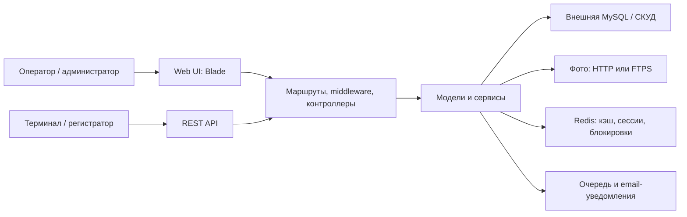

# Архитектура PhotoAuthApp

## Обзор

PhotoAuthApp построен как монолитное Laravel-приложение. Веб-интерфейс и REST
API используют общую предметную модель и сервисы, но предназначены для разных
клиентов: людей-операторов и внешних устройств СКУД.

## Слои

### Точки входа

- `routes/web.php` — страницы входа, галереи, отчётов и администрирования.
- `routes/api.php` — интеграционный API для устройств и диагностики.
- `public/index.php` — вход Laravel для HTTP-запросов.
- `artisan` — консольные команды, включая генерацию миниатюр.

### HTTP-слой

Контроллеры в `app/Http/Controllers` реализуют сценарии интерфейса и API.
Основные зоны: галерея, отчёты по проходам, рабочее время, пользователи,
устройства, настройки, журналы ошибок и API.

Middleware обеспечивает сессионную авторизацию, проверку роли администратора,
API-токен, идентификатор запроса и аудит вызовов API.

### Предметные данные

Основные таблицы внешней СКУД:

- `passage` — события проходов;
- `mergedvisitcontrol` — данные сотрудников;
- `webusers` и `role` — учётные записи и роли;
- `controllers`, `cameras`, `location` — оборудование и локации;
- `pairdevices` и `pair_device_devices` — логические пары устройств.

Служебные таблицы приложения включают `Logs`, `settings` и
`change_histories`.

### Сервисы

- `AppSettingsFileStore` — хранит конфигурацию установки в
  `storage/app/settings.json`; чувствительные поля шифруются Laravel Crypt.
- `BootstrapConfigService` — первичная настройка и мастер-доступ.
- `LicenseService` — проверка лицензии.
- `ErrorNotificationService` и `TelegramLogger` — журналы и уведомления.
- `ChangeHistoryService` — аудит изменений моделей оборудования и пользователей.

### Внешние интеграции

- MySQL — основной источник данных СКУД; параметры могут задаваться через
  окружение или защищённый файл настроек.
- HTTP/FTPS — чтение фотографий и генерация миниатюр.
- Redis — кэширование отчётов и справочников, сессии, cache locks.
- SMTP/email — асинхронные уведомления об ошибках.

## Основные потоки

### Вход и роли

Пользователь входит через `FtpAuthController`. Защищённые страницы требуют
сессию, а изменение оборудования, пользователей и настроек дополнительно
требует роль администратора.

### Проходы и рабочее время

`PassageController` читает проходы, сопоставляет их с сотрудниками, рассчитывает
интервалы работы и формирует HTML-отчёт или Excel-экспорт. Справочники и готовые
расчёты кэшируются в Redis.

### Фотографии

`FtpAuthController` и `ThumbnailController` получают фотографии из внешнего
хранилища. Миниатюры сохраняются в публичном хранилище Laravel; блокировка Redis
предотвращает параллельную повторную генерацию одной миниатюры.

### Внешний API

Клиент передаёт `X-Api-Token`; для трассировки поддерживаются `X-Request-Id` и
`X-Client-Id`. API возвращает пары устройств, настройки, пользователей и
диагностические сведения. Ошибки имеют единый JSON-формат и записываются в
журнал.

## Развёртывание

`compose.yaml` запускает контейнер приложения и Redis. В образе выполняются
подготовка хранилищ, кэширование конфигурации Laravel и, при включённом флаге,
миграции. Основной HTTP-порт — `27017`.

## Ограничения и технический долг

- В части контроллеров сосредоточены и HTTP-сценарии, и значительная бизнес-
  логика; при расширении её стоит постепенно выносить в отдельные сервисы.
- Схема связей устройств развивалась через несколько совместимых миграций;
  при изменениях нужно сохранять обратную совместимость с данными СКУД.
- Формат настроек и контракт API являются интеграционными контрактами: их нельзя
  менять без проверки внешних терминалов и регистратора.
