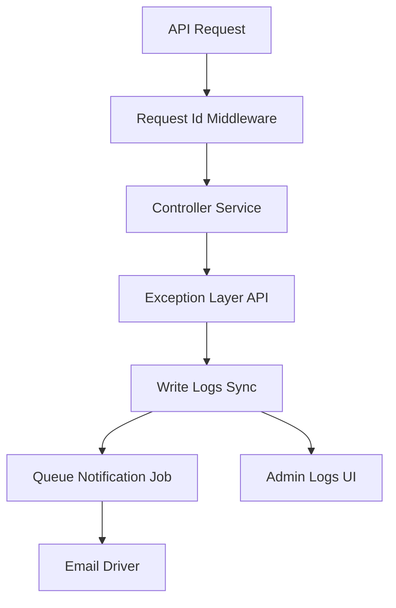

# План расширения API-системы логов и уведомлений под 5x нагрузку

## 1. Цель

Расширить текущую реализацию логирования и уведомлений для всех API-вызовов так, чтобы система стабильно работала при росте нагрузки от клиентских приложений на точках и центрального сервера-регистратора.

Ключевые требования:
- единый JSON-формат ошибок для всего API
- гарантированная запись 5xx в таблицу Logs
- отправка Email для критических событий без блокировки API-ответов
- защита от штормов повторяющихся ошибок
- расширенный аудит API-запросов в Logs

Обозначения HTTP-статусов:
- 4xx — ошибка на стороне клиента или запроса клиента
- 5xx — внутренняя ошибка сервера

## 2. Текущее состояние

Уже реализовано:
- централизованная запись ошибок через ErrorNotificationService
- отправка Email
- разделение пользовательских и внутренних ошибок в глобальном exception flow
- админский журнал логов и тестовый запуск уведомлений

Для API нужно добавить расширения под высокую нагрузку.

## 3. Целевая архитектура для API

Принцип:
- API не ждёт сетевую отправку в каналы
- API быстро отвечает клиенту
- каналы уведомлений обрабатываются очередью и retry-механизмом

## 4. Единый контракт ошибок API

Для всех `/api/*` вводится стандарт ответа об ошибке:
- `success`: false
- `error.code`: машинный код
- `error.message`: безопасный текст для клиента
- `error.request_id`: корреляционный id
- `error.timestamp`: ISO-время

Правила:
- 4xx: валидация и бизнес-ошибки, без технических деталей
- 5xx: только безопасное сообщение, детали только в Logs
- trace и stack никогда не возвращать клиенту

## 5. Политика логирования и уведомлений

### 5.1 Что писать в Logs

Для каждого 5xx и для важных 4xx:
- Message: короткий заголовок события
- LogType: уровень `error` или `critical` или `fatal`
- IPAddress: клиентский IP через текущий resolver
- StackTrace: структурированный JSON-контекст

В StackTrace добавлять:
- request_id
- route
- method
- status_code
- duration_ms
- client_app_id или идентификатор точки
- exception_class
- safe_context

### 5.2 Что отправлять в каналы

- Email: только `error` и выше
- Telegram: отключён в рабочем контуре
- 4xx массового типа не отправлять
- для повторов включить дедупликацию по fingerprint окну времени

## 6. Контур высокой нагрузки

### 6.1 Синхронная часть

Синхронно в запросе:
- генерация `request_id`
- запись события в Logs
- возврат API-ответа

### 6.2 Асинхронная часть

Асинхронно через очередь:
- отправка Email
- retry и backoff
- ограничение частоты отправки

### 6.3 Антишторм

Ввести механику:
- fingerprint на основе route, code, message, class
- rate-limit на уведомления по fingerprint
- агрегирование повторов с периодической сводкой

## 7. API-аудит

Для наблюдаемости при 5x добавить аудит событий API:
- входящий запрос
- код ответа
- длительность
- отказы авторизации 401 и 403
- срабатывание лимитов 429

Реализация без новой таблицы:
- хранить аудит в Logs как `info` или `notice`
- при всплесках включать sampling для штатных успешных ответов

## 8. Изменения по слоям

### 8.1 Middleware

Добавить middleware корреляции:
- принять `X-Request-Id` если пришёл
- иначе сгенерировать новый
- вернуть в response header
- положить в request attributes для сервисов

### 8.2 Exception handling

В `bootstrap/app.php`:
- унифицировать JSON-ответы для API-ошибок
- отделить 4xx и 5xx правила логирования и уведомлений
- гарантировать включение `request_id` в ответ

### 8.3 ErrorNotificationService

Расширить сервис:
- режим API контекста
- формирование fingerprint
- запись служебных полей аудита
- dispatch jobs вместо прямой сетевой отправки

### 8.4 Notifications jobs

Добавить jobs:
- SendErrorEmailJob

Требования:
- `tries`
- `backoff`
- dead-letter подход через failed jobs
- безопасное логирование ошибок самих job

### 8.5 API контроллеры

Постепенно привести к единому стилю:
- не возвращать разнородные поля ошибок
- использовать общий helper ответа
- не дублировать логирование там, где уже работает global handler

## 9. Нагрузочная стратегия

Сценарии проверки:
- базовый рабочий поток при 5x запросов
- всплеск 5xx по одному endpoint
- массовые 401 и 403 с разных точек
- деградация внешних каналов Email или Telegram

Критерии приемки:
- API остаётся отзывчивым
- 5xx попадают в Logs
- уведомления отправляются асинхронно без блокировки ответа
- нет шторма дубликатов уведомлений
- request_id есть в каждом ошибочном API-ответе

## 10. Порядок внедрения

1. Ввести middleware `X-Request-Id` и базовый API error contract.
2. Обновить exception layer для API с разделением 4xx и 5xx.
3. Расширить ErrorNotificationService полями API-контекста.
4. Вынести Email и Telegram в jobs очереди.
5. Добавить дедупликацию и rate-limit уведомлений.
6. Добавить аудит 401 403 429 и sampling для успешных.
7. Провести нагрузочные проверки и скорректировать лимиты.
8. Обновить документацию API для клиентских приложений на точках.

## 11. Файлы для реализации в code mode

- bootstrap/app.php
- app/Services/ErrorNotificationService.php
- app/Http/Middleware/RequestCorrelationId.php
- app/Jobs/SendErrorEmailJob.php
- app/Http/Controllers/Api/*
- routes/api.php
- config/services.php
- config/queue.php
- docs/device-pairs-api.md

## 12. Риски и меры

- Риск: временная недоступность SMTP или mail-сервиса
  - Мера: не блокировать API, писать в Logs, retry через queue
- Риск: переполнение уведомлениями при аварии
  - Мера: дедуп и лимиты отправки
- Риск: утечка чувствительных данных в контексте
  - Мера: централизованный sanitizer перед записью и отправкой
